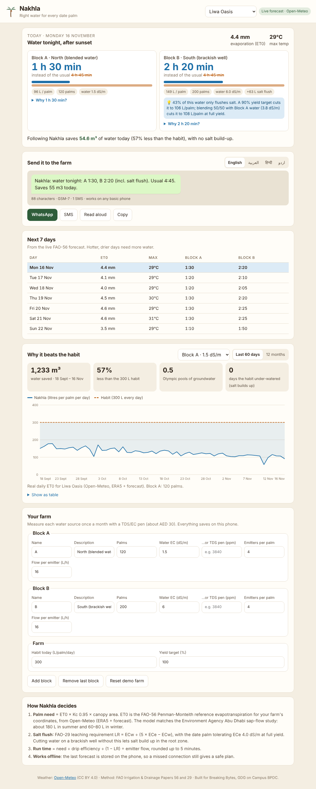

# 🌴 Nakhla: right water for every date palm

**Breaking Bytes · Problem A-001, Smart Farming for the Desert**

▶ **Live app:** https://vrishintej-dev.github.io/nakhla/ · 🎬 **Demo video:** [docs/nakhla-demo.mp4](docs/nakhla-demo.mp4) · 🗣 [Demo script](docs/DEMO-SCRIPT.md)



Nakhla tells a UAE date-farm worker exactly how long to run the drip on each block tonight, in a message short enough for a basic phone. It works this out from the day's real evaporation forecast *and* the salinity of each water source.

> Farmers give each palm ~300 L a day, all year. Palms need ~180 L in summer and 60–80 L in winter (Environment Agency Abu Dhabi sap-flow study). But "just use less water" is dangerous on a brackish well: salt builds up in the root zone. **Nakhla cuts the waste *and* adds back exactly the salt flush each well needs**, so following it is safe.

## What it does
- **Tonight's decision per block**, e.g. *Block B · 2 h 20 min instead of the usual 4 h 45 min*, with a "Why?" breakdown: palm need → drip losses → salt flush → run time.
- **Proof against the habit** on real Liwa weather: the last 60 days (daily) and the last 12 months, showing m³ saved and the days or months when the habit actually **under-watered** a salty block.
- **Hidden-problem finder:** on very salty wells it shows how much of the water only flushes salt, and how much blending with a cleaner source or a 90% yield target would save.
- **Farm message** in English, Arabic, Hindi and Urdu, with an SMS segment counter, a WhatsApp share and read-aloud for workers who don't read.
- **7-day plan** from the live forecast.
- **Works offline:** the last forecast is stored on the phone, with a bundled real Liwa snapshot as the final fallback.

## Data (real vs. realistic)
| What | Source | Real? |
|---|---|---|
| Daily ET0 (FAO-56 Penman-Monteith), max temp, rain | Open-Meteo forecast + ERA5 archive, fetched live for the chosen farm | **Real** |
| Offline snapshot: Liwa 12 Sep–22 Nov 2026 daily, Nov 2025–Oct 2026 monthly | Open-Meteo, fetched 16 Nov 2026 | **Real** |
| Habit = 300 L/palm/day | EAD / NZ Plant & Food sap-flow study (The National, 2022) | Real benchmark |
| Farm layout, palms, emitters, water EC | Demo farm, editable | Realistic |

## Method
1. Palm need (L) = ET0 × Kc (0.95, FAO-56 date palm) × 18 m² effective canopy. This is **checked against the EAD sap-flow data**: June gives 176 L and January 62 L (see the tests).
2. Leaching requirement (FAO-29, drip): LR = ECw ÷ (5·ECe − ECw), where date palm ECe = 4.0 dS/m at 100% yield (−3.6%/dS/m beyond).
3. Gross = need ÷ 0.9 drip efficiency ÷ (1 − LR). Run time = gross ÷ (emitters × flow), rounded **up** to 5 min.
4. Water too salty to leach → a warning instead of a run time.

## Run it
No dependencies. You need Node 18+ for the tests and any static server.
```bash
npm test                 # 19 unit tests (engine + messages)
python3 -m http.server 5173   # then open http://localhost:5173
```
Deploy: drag the folder onto Netlify Drop, or push it to GitHub Pages / Vercel (it's a static site).

## Stack & choices
- **Vanilla JS + SVG, zero dependencies.** It loads fast on weak 3G and has no build step to break during the demo.
- **FAO-56/FAO-29 instead of ML.** It's explainable to a grower and a judge, needs no training data and is the standard agronomists use.
- **Pure engine (`src/engine.js`)** kept separate from the UI, so it's fully unit-tested.

## Files
`src/engine.js` decision maths · `src/messages.js` multilingual SMS · `src/data.js` real weather snapshot · `src/app.js` UI · `sw.js` offline cache · `test/` unit tests · `PRODUCT-BRIEF.md` · `docs/DEMO-SCRIPT.md`

## Limitations (honest) and what we'd do next
| Drawback | Why it matters | Status / fix |
|---|---|---|
| Every palm treated the same size | Young palms need ~⅓ of a mature palm's water | **Fixed:** palm size per block (young / medium / mature canopy) |
| Assumes drippers give their rated flow | Salty water clogs drippers, so the real flow drops and palms get less than we think | **Fixed:** 1-litre bottle test per block converts to real L/h |
| Steady-state salt model (FAO-29) | We don't measure the root-zone salt itself | Next: a monthly soil EC reading per block to correct the flush fraction |
| Water EC is typed in by hand | A wrong or stale reading gives a wrong flush | Run times round **up**; unusable water is blocked; next: Bluetooth EC pen and a "re-test" reminder |
| Weather is per coordinate, not per farm microclimate | Shelter belts and humidity near the farm differ | Next: one cheap on-farm temperature/humidity logger to correct ET0 |
| Kc and canopy are textbook values | Varieties and spacing differ | Validated against EAD sap-flow (176 L June / 62 L Jan); next: calibrate with each farm's meter readings |
| No feedback loop | We don't know whether the worker actually ran the plan | Next: a WhatsApp Business bot where the worker replies "done", plus a flow meter |
| Translations not checked by native speakers | Message clarity for workers | Next: review with farm workers; read-aloud depends on the phone's voices |
| Offline fallback is Liwa only | Other farms need to be online once | Each farm's forecast is cached after its first load |
| No money figure | Owners think in AED | Next: pump energy / water-tanker cost per m³ entered by the owner |
